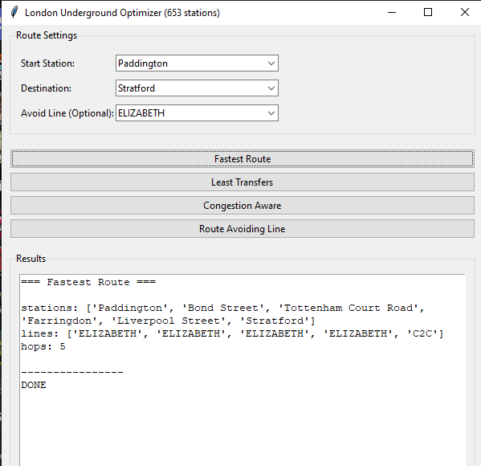
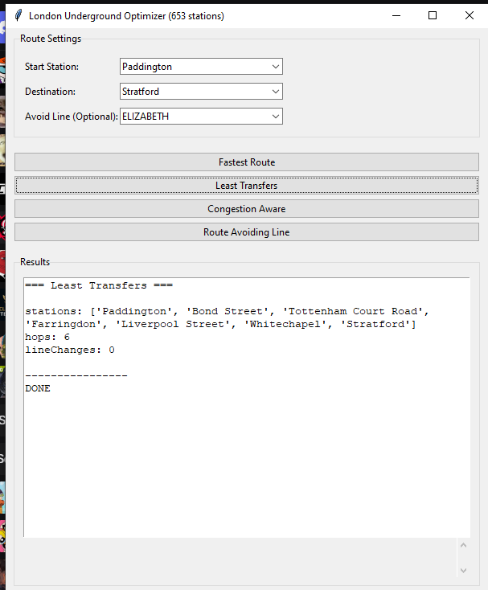
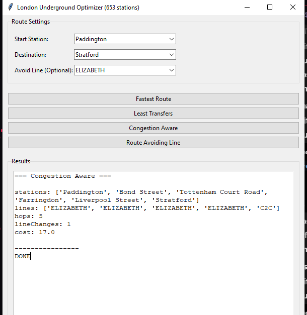
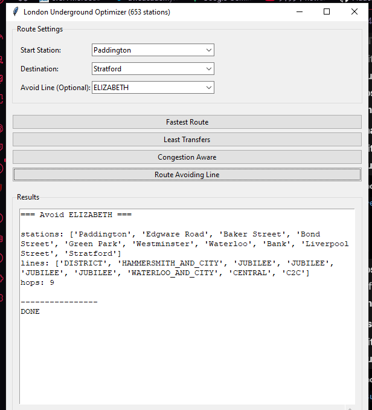

# London Underground Route Optimizer (Neo4j)

A Python + Neo4j application that finds **optimal routes in the London Underground network** under four different preferences: speed, convenience, comfort, and customization. Exposes both a CLI and a responsive multithreaded Tkinter GUI.

**Stack**: Python 3 · Neo4j (graph database) · Tkinter · `concurrent.futures` · pandas · Cypher

---

## Features

| # | Feature | Goal | Technique |
|---|---|---|---|
| 1 | **Fastest route** | Minimum number of hops | Neo4j native `shortestPath` |
| 2 | **Least transfers** | Minimum line changes | Bounded variable-length search `[*minHops..minHops+1]` + manual transfer counting |
| 3 | **Congestion-aware route** | Avoid busy stations | Heuristic bypass search parallelized with `ThreadPoolExecutor`, cost function `Hops + 2·Transfers + 0.5·CongestionScore` |
| 4 | **Avoid a specific line** | Ban one line entirely | `shortestPath` with `WHERE NONE(r IN relationships(p) WHERE type(r) = $forbidden)` |

### Fastest route


### Least transfers


### Congestion-aware route


### Avoid a line


---

## Example output (CLI)

```
Connected to london
London Underground Route Optimizer
From Paddington to Stratford

=== Fastest route ===
stations: ['Paddington', 'Bond Street', 'Tottenham Court Road', 'Farringdon', 'Liverpool Street', 'Stratford']
lines: ['ELIZABETH', 'ELIZABETH', 'ELIZABETH', 'ELIZABETH', 'C2C']
hops: 5

=== Least-transfer route ===
stations: ['Paddington', 'Bond Street', 'Tottenham Court Road', 'Farringdon', 'Liverpool Street', 'Whitechapel', 'Stratford']
hops: 6
lineChanges: 0

=== Congestion-aware route ===
stations: ['Paddington', 'Bond Street', 'Tottenham Court Road', 'Farringdon', 'Liverpool Street', 'Stratford']
hops: 5
lineChanges: 1
cost: 17.0

=== Route avoiding ELIZABETH ===
stations: ['Paddington', 'Edgware Road', 'Baker Street', 'Bond Street', 'Green Park', 'Westminster', 'Waterloo', 'Bank', 'Liverpool Street', 'Stratford']
lines: ['DISTRICT', 'HAMMERSMITH_AND_CITY', 'JUBILEE', 'JUBILEE', 'JUBILEE', 'JUBILEE', 'WATERLOO_AND_CITY', 'CENTRAL', 'C2C']
hops: 9
```

Banning the ELIZABETH line forces a detour from 5 hops to 9 — a sanity check that the line-avoidance filter actually works.

---

## Architecture

```
src/
├── db.py                      # Single Neo4j driver (reads credentials from .env)
├── main.py                    # CLI entry point (runs all four features)
├── gui.py                     # Multithreaded Tkinter GUI
├── routes_basic.py            # Feature 1 — shortestPath
├── routes_transfers.py        # Feature 2 — bounded search + transfer counting
├── routes_congestion.py       # Feature 3 — parallel heuristic rerouting
├── routes_avoid_line.py       # Feature 4 — forbidden relationship filter
└── routes_info.py             # list_stations / list_lines / network_stats
```

### Performance optimizations

- **Singleton driver** — one Neo4j connection shared across all queries (no per-query handshake)
- **Bounded variable-length search** for Feature 2 (`[*minHops..minHops+1]`) — prevents the exponential blowup that caused the Neo4j `MemoryPoolOutOfMemoryError` in early versions
- **ThreadPoolExecutor** in Feature 3 — evaluates candidate bypasses in parallel, keeping the CPU busy on this heuristic step
- **UI/logic decoupling** — the Tkinter GUI dispatches every heavy query to a background thread via `threading.Thread`, so the window never says *"Not Responding"*

---

## Quickstart

### 1. Install Neo4j and load the London Underground dataset

Any Neo4j 5.x instance works (Desktop, Aura, Docker…). The graph model expected by the code:

- Nodes labelled `:Station` with a `name` property
- Relationships named after the line they belong to (`:CENTRAL`, `:JUBILEE`, `:ELIZABETH`, `:HAMMERSMITH_AND_CITY`, `:C2C`, `:WATERLOO_AND_CITY`, `:DISTRICT`, etc.)

### 2. Configure the connection

```bash
cp .env.example .env
# then edit .env with your NEO4J_URI, NEO4J_USER, NEO4J_PASSWORD, NEO4J_DATABASE
```

### 3. Install Python deps

```bash
pip install -r requirements.txt
```

### 4. Run

```bash
# CLI — runs the four features sequentially
python src/main.py

# GUI — Tkinter window with station/line pickers and result panel
python src/gui.py
```

---

## Context

Academic project at **EMSI Casablanca** · Module NoSQL · January 2026. The goal was to go beyond a toy `shortestPath` demo and build a real route-optimization application with four distinct Cypher strategies, measured performance, and a responsive desktop UI.

## Author

**Anass Habachi** — Student engineer in AI & Data Science (EMSI Casablanca).
Looking for a 6-month end-of-studies internship (PFE) in Data Engineering / AI infrastructure starting February 2027.
